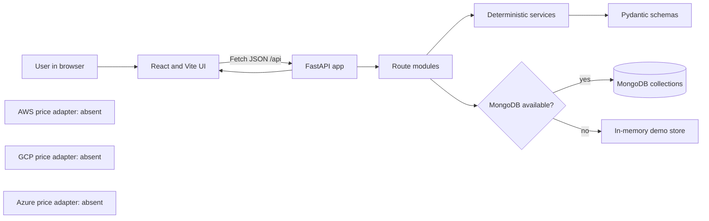

# CloudOptima — Multi-Cloud Spot Instance Arbitrage Engine

**Tagline:** Compare verified cloud compute costs, account for migration overhead, and move workloads only when the evidence supports it.

> **Implementation honesty:** The repository currently provides a demo application, deterministic calculator, conservative no-price decision behavior, and simulated migration workflow. It does not fetch AWS, GCP, or Azure prices and does not provision cloud resources.

## 1. Problem statement

An organization may run workloads on more than one cloud and want to understand whether another provider’s Spot/Preemptible compute could reduce cost. Comparing only hourly sticker prices can be misleading: duration, region, instance compatibility, data egress, migration effort, pricing freshness, interruption behavior, and availability all matter.

CloudOptima is intended to make those assumptions visible and calculate a deterministic estimate. In the current build, no provider price sources are connected, so the application deliberately declines to make a cross-cloud price recommendation.

## 2. Objectives

- Provide a single dashboard for cloud-cost and migration concepts.
- Validate and normalize provider price records before comparing them.
- Calculate current/target cost, one-time transfer and migration costs, net savings, savings percentage, and break-even.
- Recommend only from compatible and sufficiently fresh candidate data; otherwise stay on the current provider.
- Model a gated migration workflow without claiming a simulated operation is real.
- Keep provider secrets server-side and avoid accidental billable operations.

## 3. Actual technology stack

| Technology | Actual use in this repository |
|---|---|
| React 19 | UI components and page state |
| Vite 8 | Frontend dev server/build; scripts in `package.json` |
| JavaScript + JSX | Current frontend source; it is **not TypeScript** |
| CSS | Responsive custom interface styles in `src\App.css` and `src\index.css` |
| Python 3.11+ | Backend runtime; local `uv` lock currently selects an available Python |
| FastAPI | HTTP API, OpenAPI docs, route composition |
| Pydantic 2 | Request/normalized-price validation in `backend\app\schemas.py` |
| PyMongo AsyncMongoClient | Optional asynchronous MongoDB driver |
| python-dotenv | Loads `backend\.env` |
| uv | Dependency lock and backend virtual environment (`pyproject.toml`, `uv.lock`) |
| pytest + FastAPI TestClient | Backend tests |
| MongoDB | Optional persistence; explicit memory fallback when unavailable |

The original specification mentioned TypeScript, Tailwind, React Router, TanStack Query, Recharts, Axios, shadcn/ui, cloud SDKs, and Groq. Those are **not dependencies or active integrations** in the current code; the interface uses native components/CSS and Fetch API.

## 4. Architecture and request flow



The app is assembled in `backend\app\main.py`, which adds CORS for `FRONTEND_ORIGIN` and includes routers. `src\App.jsx` loads health, pricing, and migrations from `/api`. If the API is unreachable because of a network failure, some calculator and migration actions have browser-local fallbacks; those results are not backend-persisted. HTTP errors are surfaced rather than presented as successful live actions.

## 5. Implementation status

| Feature | Status | Evidence/behavior |
|---|---|---|
| Dashboard and responsive navigation | Implemented UI | `src\App.jsx`, `src\App.css` |
| Cloud price display | Empty/unavailable state | `GET /api/pricing` returns `items: []` |
| AWS Spot price adapter | Missing | No SDK/provider adapter; `AWS_PROFILE` is not consumed |
| GCP pricing adapter | Missing | No client/API call; GCP env values are placeholders |
| Azure Retail Prices adapter | Missing | No HTTP/API call; Azure env value is placeholder |
| Price schema/normalization utility | Partly implemented | `PriceRecord`, `normalize_price`, `is_fresh`; no live retrieval path |
| Cost calculator | Implemented | API and browser fallback accept caller-entered values |
| Decision logic | Service implemented; API has no candidates | API passes an empty list, returns current provider and `null` savings |
| MongoDB | Optional partial persistence | Indexes and store exist; costs/migrations/audit events are persisted when connected |
| Migration workflow | Simulation only | State transitions and health gate; no cloud resources or real traffic switch |
| DNS | Mock only | Validates URL and health flag; does not alter DNS |
| Analytics | Basic | Saved analyses and migration counts; not a historical provider price series |
| Cloud provisioning | Disabled/not implemented | No provider SDKs, credentials, or resource creation/termination |
| Authentication/authorization | Missing | API is intended for local demo only |
| Groq explanation | Missing/placeholder | Environment variable exists but no Groq client or endpoint |
| Scheduler/WebSocket | Missing | No background refresh task or progress socket |

## 6. Frontend features and behavior

### Dashboard

Shows price-record count, latest entered calculation/savings state, decision state, migrations, pricing comparison panel, and activity. Since API pricing currently returns no records, the dashboard displays empty/unavailable states rather than a fabricated chart.

### Cloud Pricing

Calls the pricing list/refresh routes. Current response has no records and reports that adapters are unavailable. There is no static provider-price seed in the UI.

### Cost Calculator

Accepts current/target hourly compute prices, duration, transfer/egress, migration overhead, other costs, provider names, and savings threshold. The values are user-entered; they should come from a quote or be clearly labeled as a classroom arithmetic example.

### Decision Engine

Collects current provider, current hourly cost, duration, capacity, region, transfer/migration assumptions, and savings threshold. The current API calls the decision service with an empty pricing list, so no candidate can be ranked. This is a deliberate conservative result, not a live optimization.

### Migration Center

Creates a simulation, displays its timeline, offers a health-check pass/fail control, and allows advance/cancel. The frontend can fall back to a browser-only simulation if the API is unreachable; those operations remain simulations. Neither frontend nor backend provisions a cloud instance.

### Analytics and Settings

Analytics displays saved cost calculations and migration counts available in the current process/database. It is not a historical pricing chart from provider feeds. Settings shows backend/MongoDB and integration status; it does not expose credentials.

## 7. Backend modules

| File/module | Responsibility |
|---|---|
| `backend\app\main.py` | FastAPI lifecycle, CORS, router composition |
| `backend\app\routers\settings.py` | Health and settings status |
| `backend\app\routers\pricing.py` | Empty pricing response and unavailable refresh |
| `backend\app\routers\costs.py` | Validated cost-calculation endpoint and saving result |
| `backend\app\routers\decisions.py` | Recommendation endpoint; currently sends no prices |
| `backend\app\routers\migrations.py` | Create, list, read, advance, cancel simulation |
| `backend\app\routers\analytics.py` | Saved analysis and migration count response |
| `backend\app\routers\dns.py` | Mock DNS endpoint |
| `backend\app\schemas.py` | Pydantic price, cost, decision, and migration request models |
| `backend\app\services\pricing.py` | Price schema validation, default USD, 24-hour freshness helper |
| `backend\app\services\costs.py` | Deterministic estimate formulas |
| `backend\app\services\decisions.py` | Capacity/region/freshness checks and cost ranking when passed records |
| `backend\app\services\migrations.py` | Simulation state machine and terminal-state guards |
| `backend\app\adapters\dns.py` | Mock-only URL and health validation |
| `backend\app\db.py` | Async MongoDB setup/indexes and memory fallback |

The pricing normalization utility is not called by a live adapter because no adapter exists. The decision service can process supplied records in unit tests; the public decision endpoint currently has no retrieval source and passes `[]`.

## 8. API surface

Base URL: `http://localhost:8000/api`; interactive schema: `http://localhost:8000/docs`.

| Method | Path | Response behavior |
|---|---|---|
| GET | `/health` | App mode, persistence, integration availability |
| GET | `/pricing` | Empty prices with warnings |
| POST | `/pricing/refresh` | No records; reports no adapter queried |
| POST | `/cost/calculate` | Cost breakdown and assumptions |
| POST | `/decisions/recommend` | Stay-put recommendation when input price list is empty |
| GET | `/analytics/savings` | Saved calculations and migration counts |
| POST | `/migrations` | Create simulation, HTTP 201 |
| GET | `/migrations` | List simulations |
| GET | `/migrations/{migration_id}` | Fetch simulation; HTTP 404 if missing |
| POST | `/migrations/{migration_id}/advance` | Advance a state; health gate and terminal-state checks |
| POST | `/migrations/{migration_id}/cancel` | Cancel non-terminal simulation |
| GET | `/settings/status` | Health/integration status |
| POST | `/dns/simulate` | Mock DNS response; expects endpoint and healthy query parameters |

Pydantic input validation produces HTTP 422 for invalid values. Invalid migration state changes use HTTP 409; live operations are rejected. Example JSON is in `backend\requests.http`.

## 9. Pricing, normalization, and data provenance

The normalized `PriceRecord` schema expects:

- provider, region, and instance type;
- positive vCPU and memory;
- non-negative hourly price and USD currency;
- pricing type, source, observation timestamp, freshness;
- availability evidence and interruption-risk label.

`normalize_price()` defaults a missing currency to USD and validates through Pydantic. `is_fresh()` treats prices within 24 hours as fresh and rejects future timestamps. These utilities are unit-tested, but they do not fetch or persist provider records on their own.

Different price types must not be casually mixed:

- **Demo/example values:** manually entered for arithmetic; not provider data.
- **Public catalog/retail rates:** published prices for SKUs; may differ from negotiated bill.
- **Spot price/history:** provider-defined Spot/Preemptible pricing, which still does not promise capacity or uptime.
- **Cached/stale price:** a prior observation; its source and timestamp matter.
- **Actual billed cost:** account-specific bill including usage, discounts, taxes, and other services; not implied by a public price API.

Before comparing, adapter code must prove same currency, billing unit, region, compatible SKU/CPU/memory, price type, source, and acceptable observation age. Never label catalog or sample data “live Spot price” without verifying that claim.

## 10. Deterministic cost model

The implementation in `backend\app\services\costs.py` uses:

```text
current cost      = current hourly cost × duration
target compute    = target hourly cost × duration
target total      = target compute + transfer + migration overhead + other costs
net savings       = current cost − target total
savings percent   = net savings ÷ current cost × 100, if current cost > 0
break-even hours  = (transfer + migration overhead + other costs)
                    ÷ (current hourly price − target hourly price),
                    only when current hourly price is higher
```

Example using **classroom-only invented inputs** (not provider quotes):

- Current: `$0.10/hour × 720 hours = $72.00`.
- Target compute: `$0.07/hour × 720 = $50.40`.
- Transfer `$12` + migration overhead `$5` + other `$3` are one-time costs.
- Target total: `$50.40 + $12 + $5 + $3 = $70.40`.
- Net savings: `$72.00 − $70.40 = $1.60`.
- Savings percent: `$1.60 ÷ $72.00 × 100 ≈ 2.22%`.
- Break-even: `$20 ÷ ($0.10 − $0.07) ≈ 666.7 hours`.

Negative inputs and non-positive duration are rejected by Pydantic. A zero current total yields zero savings percentage instead of dividing by zero. Taxes, negotiated discounts, licensing, storage, and other services are excluded unless entered as other costs. Transfer and migration costs are one-time amounts and are not multiplied by duration.

## 11. Decision model and risk

When the service receives candidate `PriceRecord`s, it rejects incompatible regions/capacity and stale/non-USD data, calculates full target cost, checks the configured savings threshold, and sorts by total cost. If no eligible alternative clears the threshold, it stays with the current provider.

**Current API limitation:** `/api/decisions/recommend` passes an empty list. Thus the working endpoint returns the current provider, no candidates, and `estimated_net_savings: null`; no live provider comparison occurs.

Even a lower computed price does not confirm:

- Spot capacity is available in a target zone;
- workload architecture/OS/licensing/data are compatible;
- interruption risk is acceptable;
- egress, data consistency, latency, or service dependencies are safe.

Those need reliable provider evidence and workload-specific checks before any real decision.

## 12. MongoDB and persistence

`DocumentStore` attempts asynchronous connection at application startup, pings MongoDB, and creates indexes. On failure it logs a warning and switches to an in-memory store; `/api/health` identifies the mode. The memory fallback is not persistent.

Indexes are prepared for these collection names:

| Collection | Current status |
|---|---|
| `pricing_snapshots` | Index exists; no live pricing data is written |
| `workload_configs` | Index exists; no workload CRUD endpoint/storage flow |
| `cost_analyses` | Used by cost-calculation route |
| `migrations` | Used by simulation routes; unique migration ID index |
| `audit_logs` | Decision and migration actions write audit documents |

The data is shared application metadata, not a distributed workload datastore. No automatic multi-region replication, cross-cloud DR, or app-state migration is implemented.

## 13. Migration and DNS safety

The simulation transition sequence is:

```text
PENDING → PROVISIONING → DEPLOYING → HEALTH_CHECK
→ READY_TO_SWITCH → SWITCHING_TRAFFIC → VERIFYING → COMPLETED
```

Failure/cancellation stop the flow, and the source remains active on a failed health check. In this implementation, these are recorded simulation transitions: the labels do not mean a VM was provisioned, application data copied, or traffic actually switched. Backend rejects requests that attempt live migration.

DNS adapter validates an HTTP(S) endpoint and a health flag but returns `status: simulated`; it does not contact DNS. Real DNS propagation is not instantaneous and would need independent resolution/traffic verification. A future real migration requires target health, data consistency, verified traffic switching, old workload retention, and tested rollback before completion can be reported.

## 14. Security

- Backend `.env` is Git-ignored; `.env.example` contains placeholders/defaults only.
- Keep API keys, cloud identities, and MongoDB password on the backend. Never place secrets in Vite `VITE_` variables.
- CORS uses the configured frontend origin; app has no authentication/authorization, so keep it bound to loopback for a demo.
- No cloud resource write operation is implemented. Do not grant write permissions to this demo.
- Use least privilege and short-lived identities for future provider integrations. Avoid root keys and globally open MongoDB network access.
- Before any live provisioning exists, require explicit confirmation, budgets/cost controls, scoped permissions, idempotency, health gates, and rollback.

## 15. Local demo flow

1. Follow the PowerShell startup commands in [IMPLEMENTATION_GUIDE.md](./IMPLEMENTATION_GUIDE.md).
2. Show Dashboard and its no-pricing warning.
3. Show Cloud Pricing empty state and explain that no provider adapter is configured.
4. Manually enter the example values in Cost Calculator and explain that they are for arithmetic only.
5. Show Decision Engine staying on the current provider because no real prices exist.
6. Create a Migration Center simulation. Advance through states and demonstrate health-check failure; source remains active.
7. Open Analytics/Settings and explain memory vs MongoDB status and unavailable integrations.

## 16. Viva questions and short answers

**Q: What problem does this project target?**  
A: Comparing cross-cloud Spot/Preemptible compute costs while accounting for workload duration and migration/transfer overhead.

**Q: Why is the pricing table empty?**  
A: No provider pricing adapters are implemented or configured. Returning no records is safer than presenting invented data as live.

**Q: Does adding AWS credentials make prices appear?**  
A: No. Current environment variables are placeholders and the pricing route does not call AWS; an adapter and tested API flow must be implemented first.

**Q: How do you calculate net savings?**  
A: Current compute cost minus target compute plus transfer, migration, and other explicitly entered costs.

**Q: Why not recommend the cheapest hourly price?**  
A: Total cost, region, instance compatibility, freshness, interruption risk, capacity, and migration overhead matter; an hourly rate alone is insufficient.

**Q: Does the migration screen migrate a real workload?**  
A: No. It advances a persisted or in-memory simulation state only. No cloud SDK or resource operation is connected.

**Q: What happens when MongoDB is down?**  
A: The backend logs the failure, reports memory-only persistence, and can continue in demo mode; records will not survive process shutdown.

**Q: Is a public Azure retail price the actual bill?**  
A: Not necessarily. Contract discounts, currency, SKU, region, usage, and other charges can change actual cost; the API is a retail-rate data source.

**Q: What does the DNS adapter do?**  
A: It validates an HTTP(S) endpoint and health flag and returns a mock result. It does not modify DNS.

**Q: What is needed before enabling real migrations?**  
A: Provider-specific provisioning, explicit authorization and cost safeguards, target/data/health validation, verified traffic switch, and a tested rollback strategy.

## 17. Verification status

The current repository contains tests under `backend\tests` and frontend scripts `npm run build` / `npm run lint`. Test outcomes should be reported only after running the commands on the current checkout; the documentation task does not change application code.
